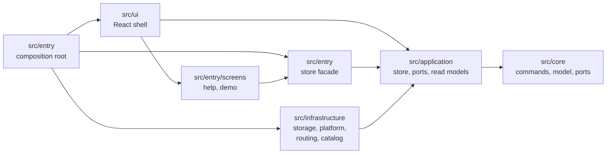

# Architecture

One static application, built by Vite into `dist/` and deployed to GitHub Pages.
No backend, no runtime dependency beyond the bundled code.

## Layers



| Layer | Owns | May import |
|---|---|---|
| `src/core` | game rules, command contracts and preparation, validated state, typed events, core ports | `core` |
| `src/application` | store transaction, snapshots, application ports, read models, command adapter | `core` |
| `src/infrastructure` | localStorage storage, platform clock/ids/seed, routing, role catalog, bag library, preferences | `application`, `core` |
| `src/ui` | React shell, router store, legacy bridge, shared components, native screens, translations, Tailwind entry and tokens | `core` (types), `application` (snapshot type), React, Radix |
| `src/entry` | composition root: store facade, locale boot, offline registration and the two DOM screens | everything |

The policy scan (`scripts/check-types-policy.ts`) enforces the direction, the
production/test split, every static import form, the ban on `node:` outside
scripts and tests, the rejection of the retired `js/` path and the restricted
assertions. It is a textual scan; review remains the second control.

## Engine access

`src/application` imports `src/core` directly: the store calls
`validateCommand`, `previewCommand` and `applyCommand` from `src/core/engine`,
and `createGame`, `importGame`, `exportGame` and `validateState` from
`src/core/model`. `src/application/dispatch/adopt.ts` is the one module that
converts the engine result union to the typed store result, and
`validatedFromUnknown` is the only path that turns raw data into a game state.

## Role capabilities

`src/core/roles/ability.ts` is the role-side contract: a resolver receives
read-only facts (the actor, the validated targets, the host's character answer,
the impairment fact, an actual-character lookup) and returns typed intents.
`src/core/engine/ability.ts` is the one coordinator: it builds the context,
applies each intent through the shared mechanic and writes the shared impairment
note. A resolver never receives the game state, so it cannot write unrelated
state, set a winner or bypass an invariant.

`src/core/roles/registry.ts` stays the single statically checked map, and
`RoleModule.ability` is optional. A migrated role no longer falls through to an
edition-specific branch. The Gambler and Pukka are migrated; the remaining role
branches stay in `bmr.ts`, `sv.ts` and `night.ts` until their own reviewed
slice, which keeps the migration reviewable role by role.

[ADR 0002](adr/0002-engine-contracts.md) defines the stage-2 contract: a typed
capability for each step kind, one coordinator order (attack, protection and
redirect, death or execution, on-death and character change, win), the command
transaction boundary, per-command execution ports and the migration order.
`src/core/roles/architecture.test.ts` locks the role-to-engine dependency
direction; no exception remains.

## Deterministic execution

`src/core/model/ports.ts` defines the one explicit record a command needs:

```ts
export interface CommandExecutionContext {
  readonly clock: { readonly now: () => string };
  readonly rng: { readonly next: () => number };
  readonly idFactory: { readonly suffix: (length: number) => string };
}
```

`runDraft` builds one record per command from the command timestamp and the
seeded generator (`createExecutionContext`), and passes it to every domain
function that stamps time, mints an id, or resolves a random deal. The clock and
the generator therefore travel as values, not through module state: a module
cannot read an ambient clock, and interleaved games cannot share a sequence.
`src/core/model/state.ts` has no clock override and `src/core/engine/execution.ts`
is gone. Direct engine calls outside a command use the immutable `systemPorts`
default; a store command always passes its own ports.

## Store transaction

```text
prepare(input)            core: id, at, rulesetVersion, fingerprint
validate(state, command)  executor: domain check on a draft
apply(state, command)     executor: mutates the live object only on success
persist()                 storage: revision, serialized value
publish()                 new snapshot, viewVersion + 1, notify
```

- Rejected or Storyteller-choice commands return before apply; nothing changes.
- A failed write restores the pre-command clone and publishes only
  `save.status = "failed"` with the unchanged game and revision.
- `getSnapshot()` returns the cached object; identity changes only at publish.
  `gameRevision` is the written revision; `viewVersion` moves on every publish.

## Save compatibility

`pg.game.v4` is the single key. The stored shape, the export envelope, the v2/v3
migration, the v3 default-name cleanup, stable player ids and `state.order` are
unchanged; the store and the model own them.

## Facade

`src/entry/store.ts` exports what the screens use: live `state`, `subscribe`,
`dispatch`, `save`, `saveIfNeeded`, `hasLocalChanges`, `undo` (boolean),
`canUndo`, `run`, `reset`, `replaceState`, `exportGame`, `importGame`,
`acknowledgeStorageError`, `loadStatus`, `playerById`, `orderedPlayers`,
`living`. The typed store keeps its results; the facade adapts them.

## UI shell

- `src/entry/main.ts` is the boot. It loads the saved locale, starts the shared
  router, builds `ShellPorts` (router, game source, role catalog, commands,
  strings, locale, assets, preferences, DOM screens) and mounts
  `src/ui/main.tsx`.
- `src/ui/router.ts` is a small store over the History/`popstate` subscription:
  a stable `{ path, version }` snapshot where `version` advances on every
  dispatch, so a bridge remounts exactly where the legacy router remounted a
  screen.
- `src/ui/shell.tsx` resolves the path: `/sheet`, `/player`, `/public`, `/bag`,
  `/seat`, `/secrets` and `/table` render native screens, every other path
  renders `legacy-bridge.tsx`, and an unknown path falls back to `/table`. The
  bridge calls the legacy `mount` and cleanup in the same effect.
- `src/ui/store/use-game.ts` is `useSyncExternalStore` over the store's cached
  snapshot. Identity changes only at publish, so there is no second state copy.
- `css/app.css` is the only stylesheet. It declares the layer order first,
  imports the Tailwind theme, Preflight and utilities into their layers,
  safelists the utilities the static document uses, holds the one `@theme`
  block and keeps a small `@layer base` reset: the document surface, form
  typography, focus visibility, `[inert]`, `[hidden]`, touch behaviour and the
  reduced-motion cancellation. Preflight is enabled because the Arcane
  Instrument screens use utilities and tokens. Utilities are scanned from
  `src/ui` and `src/entry`, never from tests or the locale catalogs
  (`source(none)` plus explicit `@source`).
- Every route styles itself with Tailwind utilities, the shared `.btn`/`.field`/
  `.label` primitives or an Arcane component;
  `css/bag.css`, `css/seat.css`, `css/setup.css`, `css/sheet.css`,
  `css/player.css`, `css/table.css` and `css/host.css` are removed.
  `scripts/check-types-policy.ts` fails when a second stylesheet appears, when
  the entry stops being a layered Tailwind entry, when a theme token is unused,
  or when a `var(--…)` reference resolves to nothing.
- Converted elements keep legacy class names as inert hooks for
  `scripts/browser-check.ts`; the classes carry no declarations.
- Runtime dependencies are `react`, `react-dom`, `@radix-ui/react-dialog` and
  `@radix-ui/react-label`; build dependencies add `vite`, `typescript`,
  `tailwindcss`, `@tailwindcss/vite`, `@types/react`, `@types/react-dom`,
  `@types/node`, `oxlint` and `oxfmt`.

## Build and publication

- `BASE_PATH` is normalized once in `scripts/base-path.ts` and feeds Vite, the
  router root, `dist/404.html` and the worker registration.
- `scripts/build-offline.ts --root dist --out dist/sw.js` hashes the artifact;
  the worker never reads the source tree.
- `scripts/serve-dist.ts` reproduces GitHub Pages: unknown paths get the real
  404 document, never an SPA fallback.

## Migration map

| Change | Scope |
|---|---|
| `adopt-layered-architecture-foundation` | typed command surface, Vite `dist/`, store factory and ports |
| `type-engine-core` | engine, model, rules, scripts and the effect graph into `core`; remove the two store ports; `js/` keeps the screens behind shims |
| `adopt-react-ui-shell` | React root, Tailwind, shared components, `/sheet` first |
| `migrate-player-screen` | `/player` |
| `migrate-setup-screens` | `/bag`, `/seat`, `/secrets` |
| `migrate-storyteller-console` | `/table`, its dialogs, `css/table.css` and `css/host.css` |
| `arcane-instrument-ui` | all routes on the Arcane Instrument tokens and component layer; setup, sheet, player and table stylesheets deleted, Preflight and the one-stylesheet reset enabled |
| `retire-legacy-js` | move every runtime module and test into `src/`, delete the `js/` tree and its shims, retire the `checkJs` program |
