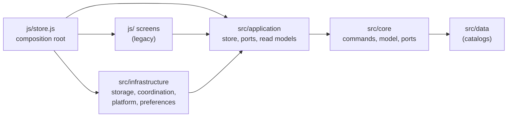

# Architecture

One static application, built by Vite into `dist/` and deployed to GitHub Pages.
No backend, no runtime dependency beyond the bundled code.

## Layers



| Layer | Owns | May import |
|---|---|---|
| `src/core` | game rules, command contracts and preparation, validated state, typed events, core ports | `core`, `src/data`, type-only legacy types |
| `src/application` | store transaction, snapshots, application ports, read models, legacy command adapter | `core` |
| `src/infrastructure` | localStorage storage, Web Locks coordination, platform clock/ids/seed, preferences | `application`, `core` |
| `js/` screens | legacy DOM screens and the engine until they migrate | `application` (through the facade), `core` |
| composition root | wires infrastructure into application; the only place that constructs implementations | everything |

The policy scan (`scripts/check-types-policy.mjs`) enforces the direction, the
production/test split, every static import form, the ban on `node:` outside
scripts and tests, the `any` ratchet and the restricted assertions. It is a
textual scan; review remains the second control.

## Engine access

`src/application` imports `src/core` directly: the store calls
`validateCommand`, `previewCommand` and `applyCommand` from `src/core/engine`,
and `createGame`, `importGame`, `exportGame` and `validateState` from
`src/core/model`. `src/application/dispatch/adopt.ts` is the one module that
converts the engine result union to the typed store result, and
`validatedFromUnknown` is the only path that turns raw data into a game state.
`js/composition.js` and the two transitional ports are gone.

## Store transaction

```text
prepare(input)            core: id, at, rulesetVersion, fingerprint
validate(state, command)  executor: domain check on a draft
apply(state, command)     executor: mutates the live object only on success
persist()                 storage: revision, serialized value
publish()                 new snapshot, viewVersion + 1, notify
```

- Rejected or Storyteller-choice commands return before apply; nothing changes.
- A failed write restores the pre-command clone and publishes only
  `save.status = "failed"` with the unchanged game and revision.
- `getSnapshot()` returns the cached object; identity changes only at publish.
  `gameRevision` is the written revision; `viewVersion` moves on every publish.

## Save compatibility

`pg.game.v4` is the single key. The stored shape, the export envelope, the v2/v3
migration, the v3 default-name cleanup, stable player ids and `state.order` are
unchanged; the codec owns them until they move into `core`.

## Facade

`js/store.js` exports what the screens use: live `state`, `subscribe`,
`dispatch`, `save`, `saveIfNeeded`, `hasLocalChanges`, `undo` (boolean),
`canUndo`, `run`, `reset`, `replaceState`, `exportGame`, `importGame`,
`acknowledgeStorageError`, `loadStatus`, `playerById`, `orderedPlayers`,
`living`. The typed store keeps its results; the facade adapts them.

## Build and publication

- `BASE_PATH` is normalized once in `scripts/base-path.mjs` and feeds Vite, the
  router root, `dist/404.html` and the worker registration.
- `scripts/build-offline.mjs --root dist --out dist/sw.js` hashes the artifact;
  the worker never reads the source tree.
- `scripts/serve-dist.mjs` reproduces GitHub Pages: unknown paths get the real
  404 document, never an SPA fallback.

## Migration map

| Change | Scope |
|---|---|
| `adopt-layered-architecture-foundation` | typed command surface, Vite `dist/`, store factory and ports |
| `type-engine-core` | engine, model, rules, scripts and the effect graph into `core`; remove the two store ports; `js/` keeps the screens behind shims |
| `adopt-react-ui-shell` | React root, Tailwind, shared components, `/sheet` first |
| `migrate-setup-screens` | `/bag`, `/seat`, `/secrets` |
| `migrate-player-and-public` | `/player`, `/public` |
| `migrate-storyteller-console` | `/table` and dialogs |
| `retire-legacy-ui` | delete the shims, the facade and the remaining `js/` screens, enable Preflight |
