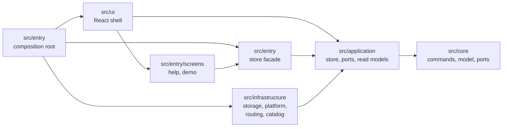

# Architecture

One static application, built by Vite into `dist/` and deployed to GitHub Pages.
No backend, no runtime dependency beyond the bundled code.

## Layers



| Layer                | Owns                                                                                                                 | May import                                                  |
| -------------------- | -------------------------------------------------------------------------------------------------------------------- | ----------------------------------------------------------- |
| `src/core`           | game rules, command contracts and preparation, validated state, typed events, core ports                             | `core`                                                      |
| `src/application`    | store transaction, snapshots, application ports, read models, command adapter                                        | `core`                                                      |
| `src/infrastructure` | localStorage storage, platform clock/ids/seed, routing, role catalog, bag library, preferences                       | `application`, `core`                                       |
| `src/ui`             | React shell, router store, legacy bridge, shared components, native screens, translations, Tailwind entry and tokens | `core` (types), `application` (snapshot type), React, Radix |
| `src/entry`          | composition root: store facade, locale boot, offline registration and the two DOM screens                            | everything                                                  |

The policy scan (`scripts/check-types-policy.ts`) enforces the direction, the
production/test split, every static import form, the ban on `node:` outside
scripts and tests, the rejection of the retired `js/` path and the restricted
assertions. It is a textual scan; review remains the second control.

## Engine access

`src/application` imports `src/core` directly: the store calls
`validateCommand`, `previewCommand` and `applyCommand` from `src/core/engine`,
and `createGame`, `importGame`, `exportGame` and `validateState` from
`src/core/model`. `src/application/dispatch/adopt.ts` is the one module that
converts the engine result union to the typed store result, and
`validatedFromUnknown` is the only path that turns raw data into a game state.

## Script definitions and composition

`src/core/model/script-definition.ts` treats a script as data: characters,
origin, teams, official night order, applicable jinxes and one compatibility
verdict. `src/core/model/interactions.ts` registers every official jinx with a
pin, a status and the asserting test that alone may justify `verified`.

An exact single-edition script keeps its own queue builder, so its step keys and
journal history do not move. A certified mixed script composes the TB, BMR and
S&V role-step builders into one queue ordered by `docs/official/nightsheet.json`;
completion stays per step and selects the existing shared or edition adapter.
`src/core/model/night-order.ts` is the one supported projection of the official
order, checked against the snapshot and each edition's published sequence.

## Role capabilities

`src/core/roles/ability.ts` is the role-side contract: a resolver receives
read-only facts (the actor, the validated targets, the host's character answer,
the host's drunk answer, the impairment fact, an actual-character lookup) and
returns typed intents.
`src/core/engine/ability.ts` is the one coordinator: it builds the context,
applies each intent through the shared mechanic and writes the shared impairment
note. A resolver never receives the game state, so it cannot write unrelated
state, set a winner or bypass an invariant.

`src/core/roles/registry.ts` stays the single statically checked map. A
migrated role no longer falls through to an edition-specific branch. The
Gambler and the Pukka were the first two; the remaining role branches stay in
`bmr.ts`, `sv.ts` and `night.ts` until their own reviewed slice, which keeps
the migration reviewable role by role.

A night step migrates to the `night-step` capability: the nights it covers
(`first`, `other` or `any`), the step the queue builds and the resolver. The
Poisoner, the Monk, the Butler, the Imp, the Empath, the Fortune Teller, the
Chef, in Bad Moon Rising, the Gambler, the Pukka, the Sailor, the
Innkeeper, the Devil's Advocate, the Exorcist, the Tinker, the Po and the
Shabaloth, and in Sects & Violets the Fang Gu, the No Dashii, the
Vigormortis, the Vortox and the Cerenovus have moved. The Sects & Violets
Clockmaker, Dreamer, Evil Twin, Flowergirl, Mathematician, Oracle and Town
Crier declare their step on the capability but keep their answers in
`svInfoForStep` until their own slice. The Snake Charmer and the Pit-Hag
declare their step on the capability and their character change on the
`transformation` capability, which `sv.ts` applies: the Pit-Hag's
`replace`, and the Snake Charmer's `swap`, which names the other player and
whether the alignments are exchanged and the player poisoned. The Sects & Violets step completion
hands a role that owns a resolver to the coordinator, as the Bad Moon Rising
one does; the four Demons' resolvers change nothing, because the host marks
their deaths on the step's outcome.
`src/core/roles/night-step.ts` is the one lookup the queue builders and the
step completion use; it reads the capability or the legacy `nightStep` and
`firstNightStep` fields, and a module declares one form only. A resolver has
one form: the `resolve` of a `night-step` capability. The `ability` field of
ADR 0001 is removed, and the Gambler and the Pukka declare their resolver on
the capability like every later role. `docs/role-ownership.md` lists which
roles have moved.

A resolver that reports a `suppressed` ability may still return the choice
that was made. The coordinator keeps a dated effect from that path as a record
that never applies, so a drunk or poisoned Butler's master stays in the
grimoire and binds no vote. `record-choice` writes the choice the step
builder reads for "different to last night" on both paths, under the acting
role's own record, so a drunk or poisoned Devil's Advocate or Exorcist still
cannot repeat it the next night. `record-no-one` writes whether the seat
chose no one, which sizes the Po's next step, also for a drunk or poisoned
Po. `record-choices` writes the players chosen tonight and keeps the record
it replaces as last night's, which the outcome reads for the Shabaloth's
regurgitation. `madness` writes the Cerenovus's token with the id the
day's review and saved games already hold, and nothing for a failed
ability.

An arm may name the kinds of dated effect that each use of the ability
replaces (`endsOnUse`). The coordinator ends the ones this ability gave
before the resolver reads the owner's health, also when the ability fails
now: the Sailor's drunkenness, and the Innkeeper's safety and drunkenness.
`givenBy` in `effects.ts` decides which effects an ability gave; the Goon's
drunkenness names its chooser as the source but stays the Goon's. The Devil's
Advocate ends its protection from execution the same way.

The Exorcist keeps the Demon from waking with `block-demon`: the role decides
that the chosen player is the Demon and writes the note and the log line,
and `keepDemonAsleep` in `bmr.ts` closes the Demon's step in tonight's queue.
What a Demon that does not wake still does stays there: the Shabaloth keeps
its regurgitation and the Pukka's waiting death resolves.

A Demon's kill is the `attack` decision: the role names the chosen player and
the title of the attack's log line, nothing else. The coordinator runs it
through `resolveAttack` with the acting seat as the attacker and the host's
answer as the Mayor's redirect, and tells the step completion what is still
owed: the shared step record, the redirect question with nothing written, or
the attack's own record, which `finishAttackStep` in `night.ts` writes. The
attack path, not the role, stops a drunk or poisoned attacker, so the table's
redirect prompt and the kill read one fact.

An information role declares the shape of its answer with its night step and
answers through the `information` capability: the value its ability learns and
every value that answer can take. It returns the same answer whether or not
its owner is drunk or poisoned. `moduleInfoForStep` in `information.ts` shows
a working ability the role's value; for an impaired owner it asks the host and
offers the possible values, the true one among them. Impairment, the question
and the check of the host's answer stay in the engine. A role may also name
the `legal` values: every answer a working ability may show when it depends
on how a Spy or a Recluse registers. With more than one the engine asks the
host and offers them, and journals the answer as a registration ambiguity.
The role reads the game only through the facts of the information context:
the seats around the circle, the living neighbours, the team a player
registers as and may register as, whether a player registers as a Demon, who
the red herring is, who died by execution today and the characters a player
may register as. The engine applies the host's registrations and the
registrant's own state behind those facts, so a role never sees them.

An answer about one player names that player. For a step that declares the
`character` shape the engine writes the record: the character, the player and
the characters the host may show, which it lists also when there is one. A
role with nothing to learn returns a note, which the engine stores as the
answer of the step, or no answer; a character step without an answer stays a
question with every character until a player is chosen.

An answer the Storyteller prepares before the first night is not computed by
the role. The Washerwoman, the Librarian and the Investigator return the
`prepared` decision and name the characters of their type. The engine reads
the record kept in setup under the role's id and writes the step: the
character and the two players, a request for setup while nothing is prepared,
or the zero setup may hold in their place. An impaired owner is offered the
characters the role names. The role is told nothing of what was prepared.

"Or that zero are in play" is the Librarian's answer alone, so the zero is a
form the role declares: the Librarian's decision carries `orZero`, the other
two do not. The engine writes the zero record, with its sentence and the
Outsider options, only for a role that declares it; a zero held for another
role is no prepared answer and the step asks for setup. Whether zero are in
play stays the Storyteller's answer in setup. A command recorded under an
older ruleset version keeps the answer it gave (`command-versions.ts`), so a
saved journal replays as it was written.

An ability that shows the Grimoire itself has no value to compute. The Spy
returns the `grimoire` decision and reads no fact. The engine records that
the Grimoire was shown, the same for an owner who is drunk or poisoned, asks
nobody, and does not store an answer sent with the step. What a Storyteller
shows an impaired Spy is done at the table; the step keeps the mark that its
owner was impaired.

The Empath, the Fortune Teller, the Chef, the Undertaker, the Ravenkeeper, the
Washerwoman, the Librarian, the Investigator and the Spy are on this path, and
`infoForStep` names no Trouble Brewing role for an answer. The information
roles of Bad Moon Rising and Sects and Violets keep theirs in `bmr.ts` and
`sv.ts`, until their own slices. The Undertaker and the Ravenkeeper still
declare their step in the legacy `nightStep` field: who wakes after an
execution or after a death at night is read from the game by the step's hooks,
and a capability never receives the game state. The step appended on the night
the Ravenkeeper dies still names the role in `night.ts`.

[ADR 0002](adr/0002-engine-contracts.md) defines the stage-2 contract: a typed
capability for each step kind, one coordinator order (attack, protection and
redirect, death or execution, on-death and character change, win), the command
transaction boundary, per-command execution ports and the migration order.
`src/core/roles/architecture.test.ts` locks the role-to-engine dependency
direction; no exception remains.

## Deterministic execution

`src/core/model/ports.ts` defines the one explicit record a command needs:

```ts
export interface CommandExecutionContext {
  readonly clock: { readonly now: () => string };
  readonly rng: { readonly next: () => number };
  readonly idFactory: { readonly suffix: (length: number) => string };
}
```

`runDraft` builds one record per command from the command timestamp and the
seeded generator (`createExecutionContext`), and passes it to every domain
function that stamps time, mints an id, or resolves a random deal. The clock and
the generator therefore travel as values, not through module state: a module
cannot read an ambient clock, and interleaved games cannot share a sequence.
`src/core/model/state.ts` has no clock override and `src/core/engine/execution.ts`
is gone. Direct engine calls outside a command use the immutable `systemPorts`
default; a store command always passes its own ports.

The ports also carry the command's ruleset version. A fix that would change
what a recorded command did adds a version to `command-versions.ts`, and the
engine branches on it where the fix applies, so a recorded command keeps its
behavior and a saved journal replays and undoes as it was written. Four
fixes do so: the zero answered for any role (`answersZeroForAnyRole`), the new
Demon's wake, repeated on the next night and late after a named heir
(`repeatsDemonWake`), the Tinker's night step, which took any death the
host marked, also while the Tinker was drunk or poisoned
(`marksAnyDeathOnTinkerStep`), and the Bad Moon Rising night steps, which
brought back any dead player the host marked, also on a step whose ability
does not resurrect (`resurrectsOnAnyStep`). A direct read outside a command
has no version and follows the rule.

## Store transaction

```text
prepare(input)            core: id, at, rulesetVersion, fingerprint
validate(state, command)  executor: domain check on a draft
apply(state, command)     executor: mutates the live object only on success
persist()                 storage: revision, serialized value
publish()                 new snapshot, viewVersion + 1, notify
```

- Rejected or Storyteller-choice commands return before apply; nothing changes.
- A failed write restores the pre-command clone and publishes only
  `save.status = "failed"` with the unchanged game and revision.
- `getSnapshot()` returns the cached object; identity changes only at publish.
  `gameRevision` is the written revision; `viewVersion` moves on every publish.

## Save compatibility

`pg.game.v4` is the single key. The stored shape, the export envelope, the v2/v3
migration, the v3 default-name cleanup, stable player ids and `state.order` are
unchanged; the store and the model own them.

## Facade

`src/entry/store.ts` exports what the screens use: live `state`, `subscribe`,
`dispatch`, `save`, `saveIfNeeded`, `hasLocalChanges`, `undo` (boolean),
`canUndo`, `run`, `reset`, `replaceState`, `exportGame`, `importGame`,
`acknowledgeStorageError`, `loadStatus`, `playerById`, `orderedPlayers`,
`living`. The typed store keeps its results; the facade adapts them.

## UI shell

- `src/entry/main.ts` is the boot. It loads the saved locale, starts the shared
  router, builds `ShellPorts` (router, game source, role catalog, commands,
  strings, locale, assets, preferences, DOM screens) and mounts
  `src/ui/main.tsx`.
- `src/ui/router.ts` is a small store over the History/`popstate` subscription:
  a stable `{ path, version }` snapshot where `version` advances on every
  dispatch, so a bridge remounts exactly where the legacy router remounted a
  screen.
- `src/ui/shell.tsx` resolves the path: `/sheet`, `/player`, `/bag`, `/seat`,
  `/secrets` and `/table` render native screens, every other path renders
  `legacy-bridge.tsx`, and an unknown path falls back to `/table`. The bridge
  calls the legacy `mount` and cleanup in the same effect.
- `src/ui/store/use-game.ts` is `useSyncExternalStore` over the store's cached
  snapshot. Identity changes only at publish, so there is no second state copy.
- `css/app.css` is the only stylesheet. It declares the layer order first,
  imports the Tailwind theme, Preflight and utilities into their layers,
  safelists the utilities the static document uses, holds the one `@theme`
  block and keeps a small `@layer base` reset: the document surface, form
  typography, focus visibility, `[inert]`, `[hidden]`, touch behaviour and the
  reduced-motion cancellation. Preflight is enabled because the Arcane
  Instrument screens use utilities and tokens. Utilities are scanned from
  `src/ui` and `src/entry`, never from tests or the locale catalogs
  (`source(none)` plus explicit `@source`).
- Every route styles itself with Tailwind utilities, the shared `.btn`/`.field`/
  `.label` primitives or an Arcane component;
  `css/bag.css`, `css/seat.css`, `css/setup.css`, `css/sheet.css`,
  `css/player.css`, `css/table.css` and `css/host.css` are removed.
  `scripts/check-types-policy.ts` fails when a second stylesheet appears, when
  the entry stops being a layered Tailwind entry, when a theme token is unused,
  or when a `var(--…)` reference resolves to nothing.
- Converted elements keep legacy class names as inert hooks for
  `scripts/browser-check.ts`; the classes carry no declarations.
- Runtime dependencies are `react`, `react-dom`, `@radix-ui/react-dialog` and
  `@radix-ui/react-label`; build dependencies add `vite`, `typescript`,
  `tailwindcss`, `@tailwindcss/vite`, `@types/react`, `@types/react-dom`,
  `@types/node`, `oxlint` and `oxfmt`.

## Build and publication

- `BASE_PATH` is normalized once in `scripts/base-path.ts` and feeds Vite, the
  router root, `dist/404.html` and the worker registration.
- `scripts/build-offline.ts --root dist --out dist/sw.js` hashes the artifact;
  the worker never reads the source tree.
- `scripts/serve-dist.ts` reproduces GitHub Pages: unknown paths get the real
  404 document, never an SPA fallback.

## Migration map

| Change                                  | Scope                                                                                                                                                              |
| --------------------------------------- | ------------------------------------------------------------------------------------------------------------------------------------------------------------------ |
| `adopt-layered-architecture-foundation` | typed command surface, Vite `dist/`, store factory and ports                                                                                                       |
| `type-engine-core`                      | engine, model, rules, scripts and the effect graph into `core`; remove the two store ports; `js/` keeps the screens behind shims                                   |
| `adopt-react-ui-shell`                  | React root, Tailwind, shared components, `/sheet` first                                                                                                            |
| `migrate-player-screen`                 | `/player`                                                                                                                                                          |
| `migrate-setup-screens`                 | `/bag`, `/seat`, `/secrets`                                                                                                                                        |
| `migrate-storyteller-console`           | `/table`, its dialogs, `css/table.css` and `css/host.css`                                                                                                          |
| `arcane-instrument-ui`                  | all routes on the Arcane Instrument tokens and component layer; setup, sheet, player and table stylesheets deleted, Preflight and the one-stylesheet reset enabled |
| `retire-legacy-js`                      | move every runtime module and test into `src/`, delete the `js/` tree and its shims, retire the `checkJs` program                                                  |
