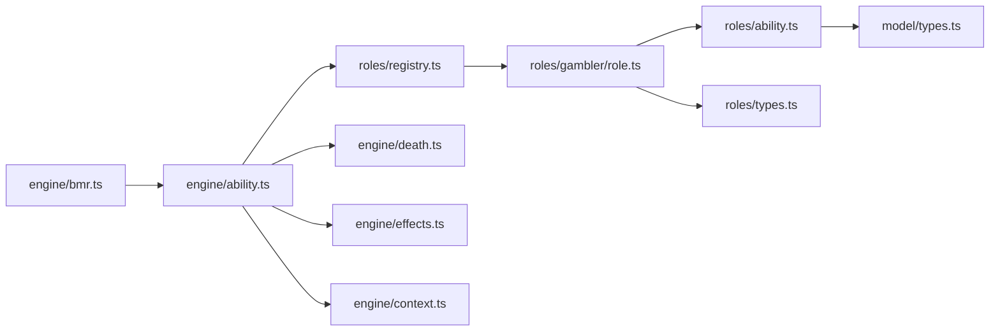

# Design

## Context

Measured on `origin/main` at `26d94a6` (2026-11-15):

- `src/core/roles/types.ts` has one `RoleModule` with `id`, `edition`,
  `nightStep`, `firstNightStep`, `deathStep` and `onDeath`. The Gambler module
  declares its step and nothing else.
- `src/core/engine/bmr.ts` resolves the Gambler at line 722: an impaired
  Gambler gets `note.abilityFailed`; otherwise a target whose actual character
  differs from `options.roleId` kills the actor through `kill()`.
- `src/core/engine/bmr.ts` is 1404 lines and still mixes role resolution with
  shared Bad Moon Rising mechanics.
- `src/core/engine/bmr.test.ts` covers a wrong guess, a correct guess and an
  impaired Gambler, but not the death record shape and not a dead target, which
  `Gambler` r3073 explicitly allows.
- `src/core/engine/night.ts` owns `setStepNote`; `bmr.ts` and `sv.ts` import it
  from there.

## Goals / Non-Goals

**Goals:**

- One contract for a role-resolved ability: read-only facts in, typed intents
  out, one engine applier.
- The Gambler rule in its module, with the same death record, status, note and
  journal output.
- A proof shape that Pukka and later roles can follow without a second
  coordinator.

**Non-Goals:**

- Moving any other role.
- A host-choice variant, a day action, a death-triggered wake or an effect
  lifetime. The Gambler needs none of them; adding unused variants now would be
  scaffolding.
- A new event, journal, command, schema field or public export.

## Decisions

### Contract types live in `src/core/roles/ability.ts`

```ts
import type { RoleId } from "../model/types.ts";

/** The facts one ability may read. The game state is not reachable. */
export interface AbilityContext {
  /** The seat taking the step. */
  readonly actorId: string;
  /** Targets the command path already validated, in the host's order. */
  readonly targetIds: readonly string[];
  /** The host's character answer for the step. */
  readonly chosenRoleId: RoleId | null;
  /** True when the effect graph says the actor is drunk or poisoned now. */
  readonly impaired: boolean;
  /** The character on a seat, never a registration or a bluff. */
  actualRoleOf(playerId: string): RoleId | null;
  /** False when the id names no seat; the old branch guarded the same way. */
  hasPlayer(playerId: string): boolean;
}

/** An intent the engine applies through a shared mechanic. */
export type RoleEffect = {
  readonly kind: "kill";
  readonly playerId: string;
};

export type AbilityDecision =
  | { readonly kind: "effects"; readonly effects: readonly RoleEffect[] }
  | { readonly kind: "suppressed" }
  | { readonly kind: "no-effect" };

/** The optional capability a role module declares. */
export interface RoleAbility {
  resolve(context: AbilityContext): AbilityDecision;
}
```

The fields are the Gambler's rule exactly: a target, a character answer, the
actor, the impairment fact and a character lookup. Sleeping on an unused field
would make the contract look broader than the evidence. The intent does not name
the ability or the edition: the coordinator records `module.id` as the ability
and derives the edition marker, so there is one source of truth.

`suppressed` is a decision, not an engine assumption. The Gambler's official
summary and the engine's established behavior are that drunk or poison removes
the ability; the Assassin and the Courtier already show that the consequence of
impairment is rule-specific, so the role states it. The engine owns the shared
note text (`note.abilityFailed` and its Russian fallback), so the wording has one
owner. A rule that needs a different note or a different step result (Pukka's
suspended poison) needs its own decision variant; `suppressed` must not grow
role-specific payload.

### The coordinator lives in `src/core/engine/ability.ts`

```ts
export function applyRoleAbility(
  state: GameState,
  module: RoleModule,
  step: NightStep,
  targets: readonly string[],
  at: DeadAt,
  chosenRoleId: RoleId | null,
): void;
```

It does nothing when the module declares no ability or the step has no actor;
the caller checks `module.ability` and otherwise keeps its own path. Otherwise
it builds the context, calls `resolve` and applies every effect. A `kill` effect
calls the existing `kill(state, playerId, "ability", at, extra)`. The `extra`
object is built conditionally: for a Bad Moon Rising module it is
`{ ability: module.id, bmr: true }`, exactly the object the old branch passed;
for another edition it is `{ ability: module.id }`. The role never decides the
recorded ability or the edition marker.

The coordinator does not re-validate targets, write a command result, set a
winner or add journal lines. `kill()` already owns protection, the Fool, the
Zombuul, the Sailor, the Tea Lady, the effect graph, the death entry, the
journal line and the win pass.

### The step completion dispatches once and never falls through

In `completeBmrStep`, after `actor.used` is normalized and before the role
branches:

```ts
const module = role ? roleModule(role) : null;
if (module?.ability) {
  applyRoleAbility(state, module, step, targets, at, options.roleId ?? null);
  return;
}
```

The Gambler branch is deleted. A migrated role cannot silently use the old
switch: if the module stopped declaring its ability, the existing
"Gambler dies on a wrong guess" test would fail because no death happens.

The dispatch point is after `applyBmrGoonTrigger` (called by `night.ts` before
`completeBmrStep`) and after the shared target and actor checks. That keeps the
Goon's immediate drunk and the dead-actor rejection in front of the ability,
which is the order the old branch had.

### `setStepNote` moves to `context.ts`

`ability.ts` must write the shared failure note. Importing `night.ts` from a
module that `bmr.ts` imports would add another edge to the existing
`night ↔ bmr` cycle. `setStepNote` is four assignments on the step, and
`context.ts` already owns the step-queue helper `insertStepInto`, so it moves
there and the three importers (`night.ts`, `bmr.ts`, `sv.ts`) point at
`context.ts`.

## Dependencies



The new capability path adds no `roles → engine` edge. `engine/ability.ts` is
imported by `engine/bmr.ts` only and is not exported from `engine/index.ts`. It
joins the existing `night → bmr → death → night` component; this slice removes
the direct `bmr → night` and `sv → night` imports that existed for
`setStepNote`, but `death → night` keeps those modules in the same component, so
the pre-existing engine cycle remains out of scope. The #177 death hook keeps
its existing engine imports; this change neither adds nor removes that edge.

## Equivalence of the Gambler path

| Input | Before | After |
| --- | --- | --- |
| Impaired actor | `note.abilityFailed` with the shared fallback; no death | resolver returns `suppressed`; coordinator writes the same key and fallback |
| Correct guess | no death | `no-effect` |
| Wrong guess, living target | `kill(actor, "ability", at, { ability: "gambler", bmr: true })` | same call from the coordinator |
| Dead target | accepted, compared `player.roleId` | accepted, compared `actualRoleOf`, `hasPlayer` guards a missing seat |
| No guess (`roleId` null) | no death | `no-effect` |
| No target | branch not entered | `no-effect` |
| Actor missing | branch not entered | coordinator returns `false`; dispatcher returns without a consequence |

No command, event, note, winner, queue, timestamp or schema field changes. The
only runtime construction is one context object per capability-driven step.

## Critical review of this slice

- **Ownership.** The role owns the rule condition and the consequence intent;
  the engine owns impairment computation, note text, death resolution and
  protection. No shared mechanic is copied into the module.
- **Direction.** Role code imports model types and the contract. The engine
  imports the registry. No new reverse edge.
- **Cycles.** The engine already has `night ↔ bmr` and `death → night`; removing
  a role from `bmr.ts` does not remove them. This slice adds no edge from a role
  module to the engine and avoids an `ability → night` edge by moving
  `setStepNote`.
- **Minimal abstraction.** One optional field, one resolver function and one
  applier. No registry change, no factory, no per-role config, no event bus.
- **No hidden fallback.** The presence of `module.ability` is the switch. A role
  cannot be half-migrated: its old branch is deleted in the same change.
- **Storyteller authority.** The guess is an input validated by the existing
  command path; the role never invents it. No registration is computed.
- **Determinism.** The module returns a list; the coordinator applies it in
  order through the existing deterministic `kill()` path. No random, clock or
  id call is added.

## Risks / Trade-offs

- A future role could declare `ability` for a step kind the coordinator does not
  bind. The ADR and the `RoleAbility` comment state that this slice binds it to
  the night step; the next slice must add the step binding with its own tests.
- The Gambler's `actualRoleOf` deliberately ignores registration. That is the
  pinned rule's distinction, and the existing comment moved with the code; a
  registration-aware guess would be a rule change and is not made here.
- `setStepNote` moves; the three importers are updated in the same change and
  the full suites prove the note output is unchanged.

## Test plan

- `src/core/roles/gambler/role.test.ts` (new, isolated): declared ability,
  wrong guess intent, correct guess, missing guess, missing seat, impaired.
- `src/core/engine/bmr.test.ts`: a characterization test for the death record
  (`cause`, `ability`, `bmr`) and a dead target, written before the move and run
  before and after.
- Full `npm run verify`, `node scripts/check-acceptance.mjs`,
  `node scripts/openspec-check.mjs`, `openspec validate --changes --strict`.

## Migration

This change is slice 1 of the sequence in the ADR. Slice 2 is Pukka, which needs
an effect intent with a lifetime and a previous-victim fact; it must not reuse
`kill` for a delayed death. Later slices add the pending-choice variant and the
other step kinds.
